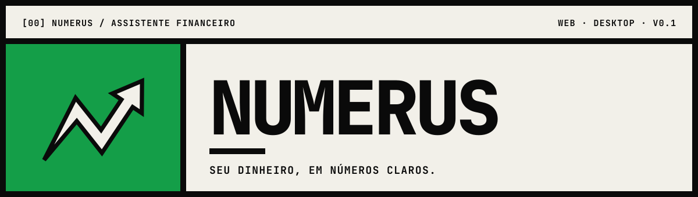
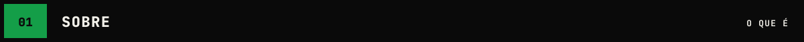
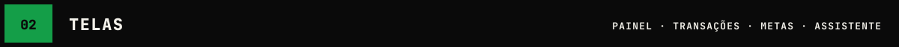
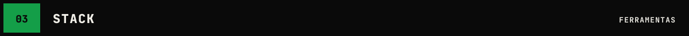
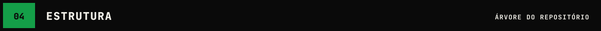
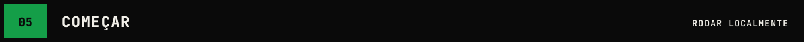
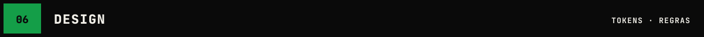
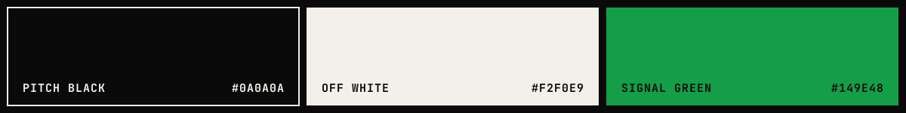
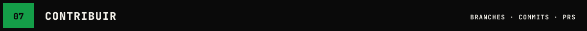

<p align="center">
  
</p>

<p align="center">
  
  
  
</p>



**NUMERUS** é um assistente financeiro pessoal para web. Ele organiza gastos, acompanha orçamento por categoria, mostra contas a vencer e responde perguntas sobre o seu dinheiro em linguagem direta.

| `[A]` REGISTRAR | `[B]` ACOMPANHAR | `[C]` PERGUNTAR |
| :-- | :-- | :-- |
| Lançar gastos e receitas em segundos | Teto por categoria, metas e contas da semana | Assistente que explica o mês e sugere ajustes |



| TELA | ROTA | O QUE MOSTRA |
| :-- | :-- | :-- |
| `HOME` | `/` | Landing page pública |
| `PAINEL` | `/app` | Disponível no mês, gasto, contas a vencer, meta de reserva, gastos por dia |
| `TRANSAÇÕES` | `/app/transacoes` | Lista filtrável de lançamentos + novo gasto |
| `METAS` | `/app/metas` | Metas de economia com progresso |
| `ASSISTENTE` | `/app/assistente` | Chat com o assistente financeiro |

> Capturas de tela ficam em [`docs/screens/`](docs/screens/). O protótipo completo está no canvas de design do projeto.



<p>
  
  
  
  
</p>

Sem biblioteca de UI: os componentes seguem os tokens em [`src/styles/tokens.css`](src/styles/tokens.css).



```text
numerus/
├── .github/
│   ├── ISSUE_TEMPLATE/
│   │   ├── bug.yml              # [BUG] relato de erro
│   │   ├── feature.yml          # [FEAT] nova funcionalidade
│   │   └── config.yml
│   ├── workflows/
│   │   └── ci.yml               # lint + typecheck + build
│   ├── labels.yml               # labels nas cores da marca
│   └── pull_request_template.md
├── assets/
│   └── brand/                   # banner, logos, mark, favicon, paleta
├── docs/
│   ├── DESIGN.md                # sistema visual completo
│   └── screens/                 # capturas das telas
├── scripts/                     # gen_svgs.py + outline_text.py (gera os svgs da marca)
├── src/
│   ├── components/              # AppShell, Mark, ui (Card, Button, KpiTile, ProgressBar)
│   ├── lib/                     # formatação de moeda, datas, cálculos de orçamento
│   ├── pages/                   # Home, Painel, Transacoes, Metas, Assistente
│   ├── styles/
│   │   ├── tokens.css           # variáveis de cor, tipo, espaço e borda
│   │   ├── tokens.json          # os mesmos tokens para scripts e testes
│   │   └── base.css             # reset + estilos globais
│   ├── App.tsx
│   └── main.tsx
├── public/favicon.svg
├── index.html
├── package.json
├── CONTRIBUTING.md
├── LICENSE
└── README.md
```



```bash
git clone https://github.com/<usuario>/numerus.git
cd numerus
npm install
npm run dev        # http://localhost:5173
```

| COMANDO | FAZ |
| :-- | :-- |
| `npm run dev` | servidor local |
| `npm run build` | build de produção em `dist/` |
| `npm run lint` | eslint |
| `npm run typecheck` | tsc sem emitir |

### Pluggy (sandbox)

Sem configuração o app usa dados de exemplo. Para analisar movimentações bancárias via [Pluggy](https://pluggy.ai):

1. Crie uma aplicação no [dashboard do Pluggy](https://dashboard.pluggy.ai) (aplicações novas já têm os conectores sandbox).
2. Copie `.env.example` para `.env` e preencha `PLUGGY_CLIENT_ID` e `PLUGGY_CLIENT_SECRET`.
3. Rode `npm run dev`, vá ao **PAINEL → CONECTAR BANCO**, escolha **Pluggy Bank** e entre com `user-ok` / `password-ok` (MFA: `123456`).

As credenciais ficam só no servidor do Vite (`server/pluggy.ts`, rotas `/api/pluggy/*`); o navegador recebe apenas o connect token e os dados. Essas rotas existem no `npm run dev` e no `npm run preview` — em produção será preciso um backend próprio.





| TOKEN | VALOR | USO |
| :-- | :-- | :-- |
| `--nm-black` | `#0A0A0A` | texto, bordas, sidebar, barras |
| `--nm-off-white` | `#F2F0E9` | fundo |
| `--nm-green` | `#149E48` | **só preenchimento**: CTA, item ativo, destaque |
| `--nm-font` | JetBrains Mono 400 / 700 / 800 | tudo |
| `--nm-u` | `8px` | grade base |

**Regras**
1. Verde é preenchimento. Nunca texto verde sobre off-white.
2. Sem `border-radius`. Bordas pretas grossas: 8 (moldura) · 6 (card) · 4 (botão) · 3 (linha).
3. Rótulos em CAIXA ALTA, `letter-spacing: 0.08em`.
4. Seções numeradas: `[01] TÍTULO`.
5. Ação principal com sombra dura `5px 5px 0 #0A0A0A`.

Detalhes em [`docs/DESIGN.md`](docs/DESIGN.md).



| ITEM | PADRÃO |
| :-- | :-- |
| Branches | `feat/…` · `fix/…` · `docs/…` · `design/…` |
| Commits | [Conventional Commits](https://www.conventionalcommits.org/pt-br/): `feat(painel): adiciona card de meta` |
| PRs | usar o template; anexar captura quando mudar UI |

Guia completo em [`CONTRIBUTING.md`](CONTRIBUTING.md).

<br>
<p align="center">
  
</p>
