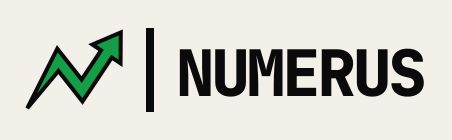
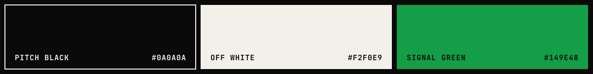

# [00] SISTEMA VISUAL

Identidade brutalista: preto, off-white e um verde de sinal. Monoespaçada em tudo, bordas grossas, nenhum canto arredondado.

## [01] MARCA

N em zigue-zague que vira seta: cauda afinando em ponto zero, pico, vale e cabeça triangular apontando para cima e para a direita.

| ARQUIVO | USO |
| :-- | :-- |
| `assets/brand/mark.svg` | marca isolada, verde com contorno preto |
| `assets/brand/favicon.svg` | favicon sobre preto |
| `assets/brand/logo-horizontal-light.svg` | marca + barra + palavra, fundo claro |
| `assets/brand/logo-horizontal-dark.svg` | idem, fundo preto, barra verde |
| `assets/brand/banner.svg` | topo do README |

Variações aprovadas: **A** positivo (verde sobre off-white) · **B** negativo (verde sobre preto) · **C** sobre verde (marca off-white).

Contorno da marca: `stroke-width` 4 no tamanho padrão, 5–6 em tamanhos pequenos. `stroke-linejoin: miter`.

## [02] COR

| NOME | HEX | TOKEN |
| :-- | :-- | :-- |
| PITCH BLACK | `#0A0A0A` | `--nm-black` |
| OFF WHITE | `#F2F0E9` | `--nm-off-white` |
| SIGNAL GREEN | `#149E48` | `--nm-green` |
| GREEN DARK | `#0E7F39` | `--nm-green-dark` |
| GRID | `#DCD9CF` | `--nm-grid` |
| MUTED | `#CFCBBF` | `--nm-muted` (dias futuros, inativo) |

**Verde = só preenchimento.** Texto sobre verde é sempre preto.

## [03] TIPO

JetBrains Mono · 800 / 700 / 500 / 400

| PAPEL | TAMANHO | PESO | TRACKING |
| :-- | :-- | :-- | :-- |
| Hero | 72px | 800 | -0.05em |
| H1 de página | 40px | 800 | -0.05em |
| KPI | 34px | 800 | -0.04em |
| Corpo destaque | 16px | 500 | 0 |
| Corpo | 14px | 400–700 | 0 |
| Rótulo | 12px | 700 | 0.08em, CAIXA ALTA |

## [04] ESPAÇO E BORDA

Grade de 8px (`1U`). Padding de card 18–20px, de página 28–32px, gaps de 20–24px.

| ELEMENTO | BORDA |
| :-- | :-- |
| Moldura da página | 8px |
| Card | 6px |
| Botão / item de nav | 4px |
| Linha de lista / barra de progresso | 3px |

`border-radius: 0` sempre.

## [05] COMPONENTES

| COMPONENTE | ANATOMIA |
| :-- | :-- |
| `SectionHeader` | faixa com borda inferior 4px, título 13px/800 à esquerda, meta à direita |
| `KpiTile` | card 6px, rótulo 12px + valor 34px; variantes `dark`, `light`, `accent` |
| `Button` primário | fundo verde, borda 4px, texto 14px/800, sombra `5px 5px 0` |
| `Button` secundário | fundo preto, texto off-white, sem sombra |
| `ProgressBar` | trilho 16px com borda 3px; preenchimento preto, verde quando acima do teto |
| `DateChip` | fundo preto, texto off-white 800, padding 4×8 |
| `NavItem` ativo | fundo verde, borda 4px preta, texto preto |
| `Badge` | borda 3px, 11px/800, tracking 0.1em (ex.: `DADOS DE EXEMPLO`, `ACIMA`) |

## [06] NÃO FAZER

- Texto verde sobre off-white
- Gradientes, sombras suaves, cantos arredondados
- Uma segunda cor de destaque
- Fonte que não seja JetBrains Mono
